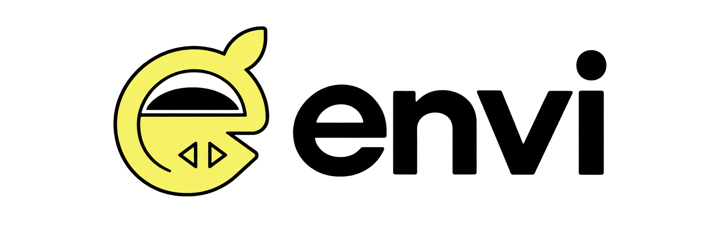
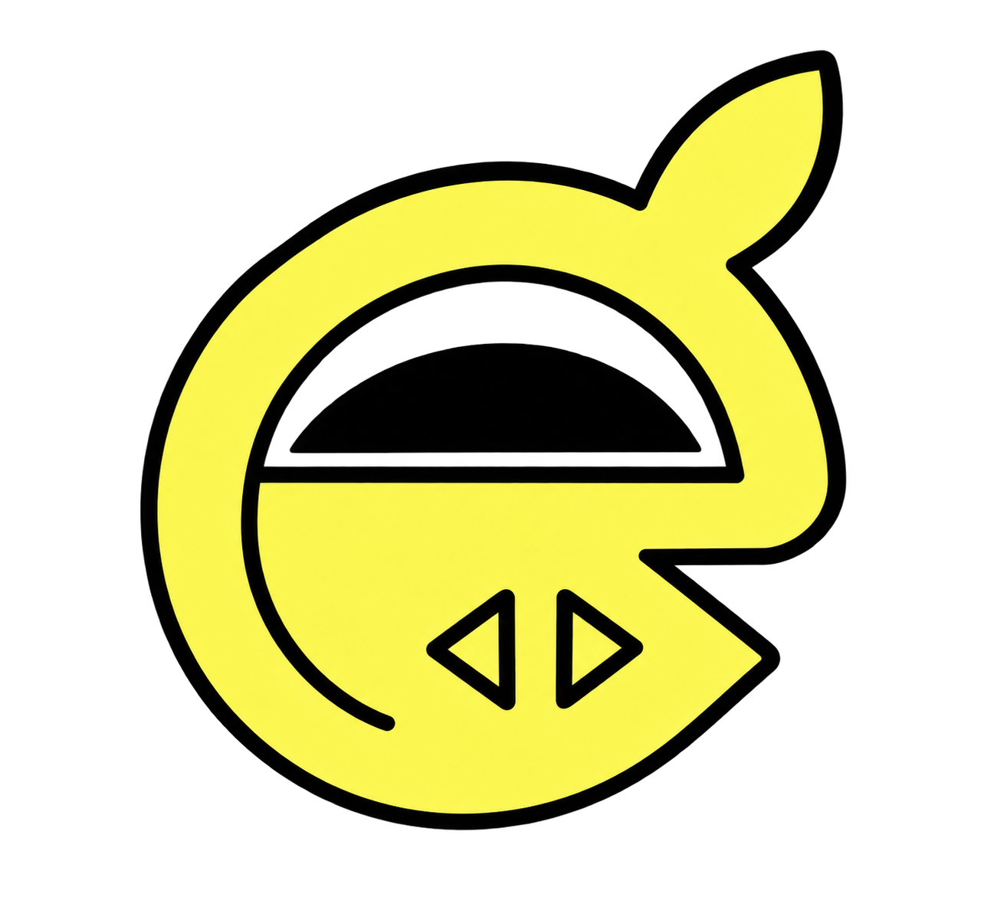
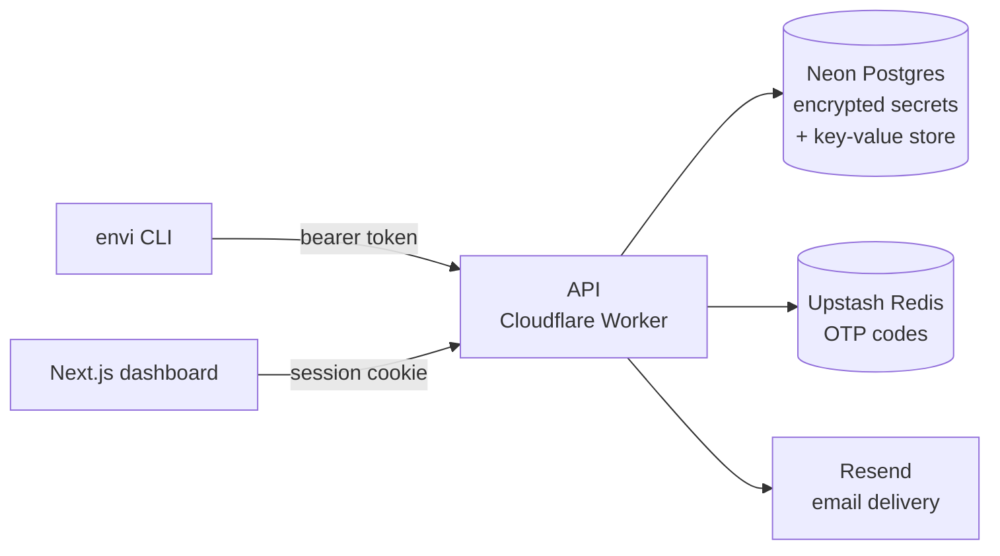

  <p align="center">
    <picture>
      <source media="(prefers-color-scheme: dark)" srcset="ui/public/envi-logo-with-text-dark-mode.png">
      
    </picture>
  </p>

  <p align="center"><strong>Environment secrets, encrypted, scoped, and audited — as a hosted product, or run entirely on your own infrastructure.</strong></p>

  <p align="center">
    
    
    
    
    
    
  </p>

  ---

  

  **Envi** is an environment-secret manager: encrypted `.env` values, scoped access, an audit trail, and a CLI that gets a secret from your database into a running process without anyone typing it into Slack. Envi is built and run as a product — this repository is also the entire self-hostable stack, for teams who'd rather keep everything on infrastructure they control.

  Full documentation: **[docs.envisecrets.com](https://docs.envisecrets.com)**

## Install the CLI

```bash
curl -fsSL https://install.envisecrets.com | sh
```

```powershell
irm https://install.envisecrets.com/install.ps1 | iex
```

The script detects your OS and CPU architecture, verifies a SHA-256 checksum before installing, and works on macOS, Linux, Termux, and Windows.

## What it does

- **Encrypted at rest** — every secret is sealed with AES-256-GCM before it touches Postgres. Nothing is ever stored in plaintext, including in the version history kept for every change.
- **Scoped access** — grant a collaborator `read`, `write`, or `manage` on a project or a single environment. Production doesn't get touched by accident.
- **Passwordless auth** — sign in with a one-time email code or approve a device from your browser. No passwords exist anywhere in the system to leak.
- **Service tokens** — long-lived, scoped credentials for CI/CD pipelines and deploy scripts, independent of any human's session.
- **Multiple environments** — dev, staging, prod as separate sets of secrets in one project. `envi origin switch prod` repoints your working directory; `envi push .env origin prod` writes to one you aren't on.
- **No `.env` on disk** — `envi run -- npm start` injects secrets into the process that needs them and exits with that process's own status. `envi mod` edits them in a terminal editor, and `envi push --clean` removes the file once it is up. Nothing plaintext has to stay on your filesystem. Prefer not to type `envi run`? `envi hook install` loads a project's secrets when you `cd` into it, after a one-time `envi allow`.
- **Runs in a container** — `ENTRYPOINT ["envi", "run", "--"]` and one `ENVI_TOKEN` variable. No `.env` in the image, no environment id baked into a layer, same image in every environment.
- **Key-value store** — a project-wide store your application reads and writes at runtime over HTTP, encrypted like everything else. Separate from your secrets: if your code writes it, it goes here; if you deploy it, it's a secret.
- **Full audit trail** — every write and delete is logged against the org, the actor, and the exact secret touched. Reads are logged once per environment with the number of secrets they covered, so a command you run all day stays readable in the feed.
- **Email invitations** — invite a teammate by address; they click through, sign in (or sign up on the spot if they're new), and land with access already waiting.
- **Copy a whole environment out** — platforms that build and run your code themselves, like Vercel or Netlify, have no process for `envi run` to wrap. **Copy all** on the dashboard puts every secret on your clipboard as `.env` text, which their environment-variable screens parse in one paste. `envi copy` does the same from the terminal, and `envi copy --single` picks out one value.
- **CLI and dashboard, one API** — `envi pull`/`push`/`diff` your `.env` files from the terminal, or manage everything visually. Same backend, same permissions, your choice of interface.

## Self-hosting

A self-hosting guide for the current server is being written. Until then, Envi is the hosted product at [envisecrets.com](https://envisecrets.com).

## How it fits together



The CLI and the dashboard are two clients of the same API — neither one is a special case. Secrets are encrypted before they reach Postgres and decrypted only in memory, on demand, for a request that has already passed the access-grant check.

## Repository layout

| Path | What it is |
|---|---|
| `server/` | The API server in TypeScript (Hono): Cloudflare Workers in production, Bun for local runs. Every route is in `src/app.ts` |
| `install/` | The install scripts and the Worker that serves them on install.envisecrets.com |
| `cli/` | The CLI in Go (`cmd/envi`, `internal/cli`), released for macOS, Linux, Termux, and Windows |
| `ui/` | The Next.js site: landing page and dashboard on envisecrets.com, and the docs (`app/docs`) on docs.envisecrets.com |
| `migrations/` | `schema.sql` for a fresh database, numbered files to catch one up |
| `docs/` | `ENDPOINTS.md` (every route) and `excalidraw.json` (system diagram, data model), rebuilt with `make diagram` |

## Security, briefly

- Secret values: AES-256-GCM, one key, sealed before every write.
- Tokens: access, refresh, service, and invitation tokens are all stored as hashes — the plaintext exists only once, at issuance, in the response the caller already has.
- Sessions: HMAC-signed, HTTP-only, `SameSite=Strict` cookies on the web; rotating refresh tokens everywhere.
- Rate limits: OTP requests and attempts are capped; invitations are capped per sender, so a compromised account can't be used to burn a sending domain's reputation.

## The CLI

| Command | What it does |
|---|---|
| `envi auth` | Sign in — browser device flow by default, `--email` for a one-time code |
| `envi init` | Link the current directory to a project and environment |
| `envi pull` | Write the environment's secrets to `.env` |
| `envi push` | Send local `.env` changes up, with conflict detection |
| `envi push <file> [origin <name>]` | Push a named file, optionally to another environment |
| `envi push --clean` | Push, then delete the file |
| `envi diff` | Show what's changed between local and remote before you push |
| `envi run -- <command>` | Run a command with the secrets injected, without writing a `.env` |
| `envi hook install` | Load a project's secrets automatically when you `cd` into it (zsh, bash, fish, PowerShell) |
| `envi allow` / `envi deny` | Let this folder load its secrets automatically, or stop it |
| `envi mod` | Edit this origin's secrets in a terminal editor, nothing written to disk |
| `envi clean` | Delete the local `.env` once the server already has it |
| `envi copy` | Copy the whole origin to the clipboard as `.env` text |
| `envi copy <key>` | Copy one secret's value |
| `envi copy --single` | Pick a secret from a list and copy it |
| `envi project create <name>` | Create a project |
| `envi key create --name <name>` | Create a personal API key |
| `envi auth --key <key>` | Sign in with an API key instead of the browser |
| `envi origin list` | List the project's environments, marking the current one |
| `envi origin switch <name>` | Point this directory at another environment and pull it |
| `envi origin create <name>` | Create an environment under the current project |
| `envi share <email>` | Invite a collaborator with scoped access |
| `envi invite accept <token>` | Accept an invitation |
| `envi token create --name <name>` | Mint a scoped service token for CI/CD |
| `envi activity` | Recent reads and writes across your org |
| `envi logout` | Revoke the current session |
| `envi update` | Check for or install a new version |
| `envi uninstall` | Remove envi from this machine |

Full reference, including flags and exit codes: [docs.envisecrets.com/cli](https://docs.envisecrets.com/cli).

## Development

Postgres and Redis running locally, then:

```bash
make dev-api      # API on :8080
make dev-ui       # site on localhost:3000, docs on docs.localhost:3000
make test         # every test; the API's run on a throwaway local database
make cli          # build the CLI
make deploy       # both Workers
```

`make help` lists every target.

## License

MIT — see [LICENSE](LICENSE).
